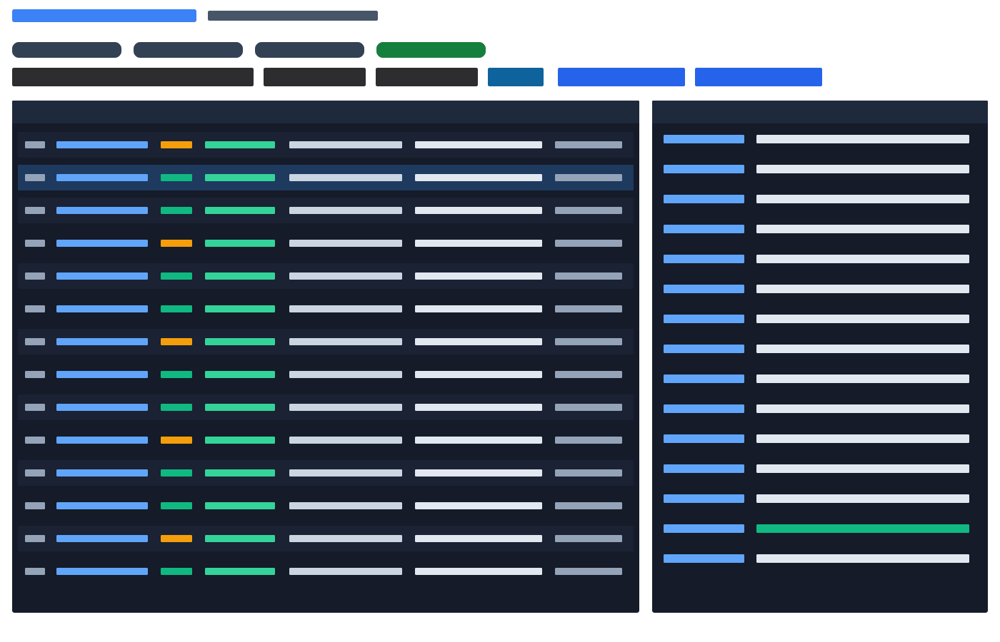

# ISO 20022 Payment Viewer for VS Code

Open ISO 20022 banking payment and statement XML files in the editor. Raw ISO 20022 XML wraps debtor IBANs, creditor BICs, remittance notes and control totals inside deeply nested tags, so checking a batch as plain text takes time and invites mistakes. This extension parses `pain.001`, `pacs.008`, `camt.053` and `camt.054` messages locally with plain JavaScript, without an external engine or cloud upload.

## What it opens

- ISO 20022 XML files (`.iso20022`, `.pain001`, `.camt053`, `.pacs008`, `.sepa`) containing single or concatenated `<Document>` messages.
- `pain.001` Customer Credit Transfer Initiation, `pacs.008` FI-to-FI Customer Credit Transfer, `camt.053` Bank-to-Customer Statement and `camt.054` Debit/Credit Notification files.
- Nothing to install, nothing uploaded.

## The free part

- Message header view: displays `GrpHdr` fields (`MsgId`, `CreDtTm`, `NbOfTxs`, `CtrlSum`, initiating party and namespace schema) plus `camt.053` opening and closing balances.
- Payment and statement table: lists every payment or statement entry with `EndToEndId`, amount, currency, debtor and creditor names, IBAN, BIC and remittance text.
- Detail inspector: select any row to inspect decoded fields, IBAN MOD-97 status, BIC format, UETR and source line number.
- Search and filter: filter payments and entries by text, message type, currency or message ID locally.
- Control-sum and count checks: verifies `CtrlSum` math, `NbOfTxs` transaction counts, `camt.053` balance math, IBAN MOD-97 checksums, BIC format and duplicate `MsgId` values.

## The Pro tools, with 1 free try

Pro adds the audit and output steps: run an ISO 20022 control-total, IBAN MOD-97, currency and duplicate `MsgId` audit report in Markdown, export payments and headers to CSV and structured JSON (`transactions.csv`, `headers.csv`, `.json`), or compare two ISO 20022 payment batches in Markdown. Your first try of each Pro tool is free. Zovo Pro is USD 19 once, and the team licence is USD 59.

## Why not raw XML

Reviewing a SEPA payment batch or a `camt.053` bank statement before release is a verification job: do the individual amounts match `CtrlSum`, does the transaction count match `NbOfTxs`, and does every creditor IBAN pass MOD-97. Raw XML hides those answers across hundreds of nested tags. A parsed payment table with group headers, IBAN checks and control-total findings shows them on one screen, offline.

## More tools by Zovo

See full docs and install options at [vscode.zovo.one/extensions/zovo-iso20022-viewer/](https://vscode.zovo.one/extensions/zovo-iso20022-viewer/), browse all Zovo VS Code extensions at [vscode.zovo.one](https://vscode.zovo.one/), or explore [Zovo Pro](https://vscode.zovo.one/pro/).
